# Maw3ed — data model

Every tenant table carries `businessId`, and its indexes start with `businessId`. Times are `timestamptz` in UTC.
No free-text notes columns anywhere (NFR-04). The ERD below is written by hand from `prisma/schema.prisma` (no generator dependency); update it in the same PR as any schema change.

## Entities
| Entity | Key fields | Belongs to | Constraints / notes |
|---|---|---|---|
| Business | slug, name, timezone (`Asia/Beirut`), locale (`en`), currency (`USD`), slotStepMin (15), bookingWindowDays (30), minNoticeMin (60), cancelCutoffMin (1440), plan (FREE/PRO), depositEnabled (false), depositThreshold (1), depositAmount (5.00), listed (false), category, area, address | none | slug unique (lowercase, `[a-z0-9-]`, reserved words blocked); tenant root; `listed` is the opt-in public directory flag; `category` is a key of `src/lib/business/profile.ts` (`barbers`, `hair-salons`, `dental-clinics`, `beauty-clinics`, `spa-massage`, `physiotherapy`, `other`) or, on rows saved before PR-1, the free text the owner typed (still read and shown as typed; it matches no category key, so such a business appears only under "All categories" in the directory until the owner picks a listed one; no backfill); `area` (nullable text, no default, PR-1) is one of `sidon`, `beirut`, `tripoli`, `jounieh`, `tyre`, `zahle`, `other`, NULL on every older row; index `Business_listed_area_category_idx (listed, area, category)` serves the area filters (EXPLAIN-checked in PR-2: used for area and area + category, not for the category-only filter or the search, which scan sequentially at pilot scale); deposits are off until `depositEnabled` |
| User | email (nullable), phone (nullable, E.164), passwordHash (nullable), name, emailVerifiedAt | none | CHECK `user_has_identity` (email or phone is set); email unique (lowercased); phone unique (a staff login, set when an activation link is used; NULLs are distinct); phone-only users have no email and no verification; can belong to several businesses; `emailVerifiedAt` NULL = unverified (soft verification, L4); the migration set it to `createdAt` for every pre-existing user |
| EmailToken | userId, kind (VERIFY, RESET), tokenHash, expiresAt, usedAt | User | tokenHash unique (only sha256 is stored); single use; VERIFY 24 h, RESET 1 h; at most 5 live unused tokens per user and kind (oldest deleted); a successful use deletes all the user's unused tokens of that kind; cleanup purges used or expired rows |
| Session | tokenHash, userId, businessId, expiresAt, lastSeenAt | User, Business | tokenHash unique; 30-day sliding expiry |
| ActivationToken | businessId, staffMemberId, userId (set when used), phone, tokenHash, expiresAt, usedAt | Business, StaffMember, User | tokenHash unique (only sha256 stored); single use; 72 h; partial unique `ActivationToken_open_staff_key` on (staffMemberId) WHERE usedAt IS NULL = one open link per staff member |
| Membership | role (OWNER, STAFF, PRACTITIONER) | User, Business | unique (userId, businessId) |
| Invite | email, role, tokenHash, expiresAt, acceptedAt | Business | single use; 72 h expiry |
| StaffMember | displayName, bookable, active, colour | Business, optional User | a receptionist has a User but is not bookable; owners may be bookable |
| Service | name, durationMin, bufferMin, price, active, sortOrder | Business | soft-deactivate, never delete |
| StaffService | — | StaffMember, Service | PK (staffId, serviceId); businessId denormalised for scoping |
| WorkingHours | weekday (0–6), startLocal, endLocal (`HH:mm`) | StaffMember | several rows per day; CHECK end > start |
| TimeOff | startAt, endAt, reason enum (VACATION, SICK, OTHER) | StaffMember | UTC instants; enum, not free text |
| Client | name, phone (E.164), email, attended, noShows, lateCancels | Business | unique (businessId, phone); counters updated in the outcome transaction |
| Appointment | startAt, endAt, blockedUntil, status, source (PUBLIC, FRONT_DESK, WAITLIST), idempotencyKey, contactEmail (F16, nullable: where THIS booking's emails go; NULL = use Client.email), contactName (F16, nullable: the name typed for THIS booking, the only name mails to a non-record address use); both nulled when the client is anonymised, confirmedAt, cancelledAt, cancelledVia (LINK, STAFF, SYSTEM), holdExpiresAt (PENDING_PAYMENT only), outcomeMarkedById, outcomeMarkedAt | Business, Client, StaffMember, Service | **exclusion constraint** on (staffId, [startAt, blockedUntil)) while BOOKED, CONFIRMED or PENDING_PAYMENT; status also ATTENDED, NO_SHOW, CANCELLED, LATE_CANCEL; unique (businessId, idempotencyKey) |
| ReminderJob | kind (BOOKING, H24, H2, LATE), channel (EMAIL, WHATSAPP), dueAt, status (PENDING, SENDING, SENT, SKIPPED, FAILED), attempts, nextAttemptAt, lockedAt, sentAt, sentById, providerMessageId, lastError | Appointment (+ businessId) | unique (appointmentId, kind, channel); partial index (status, dueAt) where PENDING |
| WaitlistEntry | serviceId, staffId?, fromDate, toDate, status (OPEN, FULFILLED, CANCELLED), contactEmail, claimingOfferId, claimingAt | Business, Client, Service, optional StaffMember | `contactEmail` is where offers go, is never copied onto the Client and is set to NULL when the client is anonymised; `claimingOfferId` / `claimingAt` are the atomic reservation held while one offer is being booked (a lease, released on failure) |
| WaitlistOffer | entryId, staffId, startAt, endAt, expiresAt, status (OPEN, CLAIMED, EXPIRED, SUPERSEDED), claimedAppointmentId, freedFromAppointmentId, batch, emailedAt | Business | unique (entryId, freedFromAppointmentId): one open offer per entry per freed slot |
| PilotBaseline | fromDate, toDate, appointments, noShows, lateCancels | Business | unique (businessId); entered by the owner from their own book |
| Payment | purpose (DEPOSIT, PLAN), appointmentId?, provider, externalId, amount, currency, status (PENDING, PAID, FAILED, EXPIRED) | Business, optional Appointment | unique (provider, externalId); indexes (businessId, status), (businessId, appointmentId) |
| RateLimitBucket | key, windowStart, count | — (no tenant) | PK (key, windowStart); index (windowStart); keys are hashed or HMAC-ed emails, IPs and phones, never raw, written by one atomic upsert, purged by `/api/jobs/cleanup` |

There is no email log table. The daily email budget (NFR-10) is the count of `ReminderJob` rows with status SENT since UTC midnight plus the `WaitlistOffer` rows created since then. Invite, verification and password-reset emails are not counted (they are rare and rate limited).

## ERD

```mermaid
erDiagram
  Business ||--o{ Membership : has
  User ||--o{ Membership : has
  Business ||--o{ Session : scopes
  User ||--o{ Session : has
  Business ||--o{ Invite : sends
  User ||--o{ EmailToken : receives
  Business ||--o{ StaffMember : employs
  User |o--o{ StaffMember : "is (optional)"
  Business ||--o{ Service : offers
  Business ||--o{ StaffService : scopes
  StaffMember ||--o{ StaffService : performs
  Service ||--o{ StaffService : "performed by"
  Business ||--o{ WorkingHours : scopes
  StaffMember ||--o{ WorkingHours : works
  Business ||--o{ TimeOff : scopes
  StaffMember ||--o{ TimeOff : takes
  Business ||--o{ Client : knows
  Business ||--o{ Appointment : holds
  Client ||--o{ Appointment : books
  StaffMember ||--o{ Appointment : serves
  Service ||--o{ Appointment : "is for"
  User |o--o{ Appointment : "marked outcome"
  Business ||--o{ ReminderJob : scopes
  Appointment ||--o{ ReminderJob : schedules
  User |o--o{ ReminderJob : "sent by"
  Business ||--o{ WaitlistEntry : holds
  Client ||--o{ WaitlistEntry : joins
  Service ||--o{ WaitlistEntry : "wanted for"
  StaffMember |o--o{ WaitlistEntry : "preferred (optional)"
  Business ||--o{ WaitlistOffer : scopes
  WaitlistEntry ||--o{ WaitlistOffer : receives
  StaffMember ||--o{ WaitlistOffer : "offered with"
  Appointment ||--o{ WaitlistOffer : "freed slot of"
  Appointment |o--o{ WaitlistOffer : "claimed as"
  Business ||--o| PilotBaseline : measures
  Business ||--o{ Payment : collects
  Appointment |o--o{ Payment : "deposit for"

  Business {
    string id PK
    string slug UK
    string name
    string category "optional, key or legacy free text"
    string area "optional, key"
    string address "optional"
    string currency
    string timezone
    string locale
    enum plan "FREE or PRO"
    boolean depositEnabled
    int depositThreshold
    decimal depositAmount
    boolean listed
    int slotStepMin
    int bookingWindowDays
    int minNoticeMin
    int cancelCutoffMin
    timestamptz createdAt
  }
  User {
    string id PK
    string email UK
    string passwordHash "nullable"
    string name
    timestamptz emailVerifiedAt "NULL = unverified"
    timestamptz createdAt
  }
  Session {
    string id PK
    string businessId FK
    string userId FK
    string tokenHash UK
    timestamptz expiresAt
  }
  Membership {
    string id PK
    string businessId FK
    string userId FK
    enum role "OWNER or STAFF"
  }
  EmailToken {
    string id PK
    string userId FK
    enum kind "VERIFY or RESET"
    string tokenHash UK
    timestamptz expiresAt
    timestamptz usedAt
  }
  Invite {
    string id PK
    string businessId FK
    string email
    enum role
    string tokenHash UK
    timestamptz expiresAt
    timestamptz acceptedAt
  }
  StaffMember {
    string id PK
    string businessId FK
    string userId FK "optional"
    boolean bookable
    boolean active
  }
  Service {
    string id PK
    string businessId FK
    int durationMin
    int bufferMin
    decimal price
    boolean active
  }
  StaffService {
    string staffId PK
    string serviceId PK
    string businessId FK
  }
  WorkingHours {
    string id PK
    string businessId FK
    string staffId FK
    int weekday
    string startLocal
    string endLocal
  }
  TimeOff {
    string id PK
    string businessId FK
    string staffId FK
    timestamptz startAt
    timestamptz endAt
    enum reason
  }
  Client {
    string id PK
    string businessId FK
    string name
    string phone "E164, unique per business"
    string email "optional"
    int attended
    int noShows
    int lateCancels
  }
  Appointment {
    string id PK
    string businessId FK
    string clientId FK
    string staffId FK
    string serviceId FK
    timestamptz startAt
    timestamptz endAt
    timestamptz blockedUntil
    enum status
    enum source
    enum cancelledVia "LINK, STAFF or SYSTEM; optional"
    string idempotencyKey "unique per business"
    string contactEmail "F16 optional, personal data, nulled on anonymisation"
    string contactName "F16 optional, personal data, nulled on anonymisation"
    timestamptz holdExpiresAt "PENDING_PAYMENT only"
    timestamptz confirmedAt
    timestamptz cancelledAt
    string outcomeMarkedById FK "optional"
    timestamptz outcomeMarkedAt
    timestamptz createdAt
  }
  ReminderJob {
    string id PK
    string businessId FK
    string appointmentId FK
    enum kind
    enum channel
    enum status
    timestamptz dueAt
    int attempts
    string providerMessageId
    string sentById FK "optional"
  }
  WaitlistEntry {
    string id PK
    string businessId FK
    string clientId FK
    string serviceId FK
    string staffId FK "optional"
    timestamptz fromDate
    timestamptz toDate
    enum status
    string contactEmail "optional, where offers go, nulled on anonymisation"
    string claimingOfferId "reservation"
    timestamptz claimingAt "reservation lease"
    timestamptz createdAt
  }
  WaitlistOffer {
    string id PK
    string businessId FK
    string entryId FK
    string staffId FK
    string freedFromAppointmentId FK
    string claimedAppointmentId FK "optional"
    enum status
    timestamptz expiresAt
    timestamptz emailedAt
    int batch
  }
  PilotBaseline {
    string id PK
    string businessId FK "unique"
    int appointments
    int noShows
    int lateCancels
  }
  Payment {
    string id PK
    string businessId FK
    string appointmentId FK "optional"
    enum purpose
    enum status
    string provider
    string externalId "unique with provider"
    decimal amount
    string currency
    timestamptz createdAt
  }
  RateLimitBucket {
    string key PK
    timestamptz windowStart PK
    int count
  }
```

RateLimitBucket has no relations on purpose: its keys are hashed or HMAC-ed emails, IPs and phones, not tenants.

## Enums
| Enum | Values |
|---|---|
| Plan | FREE, PRO |
| Role | OWNER, STAFF, PRACTITIONER |
| TimeOffReason | VACATION, SICK, OTHER |
| AppointmentStatus | BOOKED, CONFIRMED, PENDING_PAYMENT, ATTENDED, NO_SHOW, CANCELLED, LATE_CANCEL |
| AppointmentSource | PUBLIC, FRONT_DESK, WAITLIST |
| CancelledVia | LINK, STAFF, SYSTEM |
| ReminderKind | BOOKING, H24, H2, LATE |
| ReminderChannel | EMAIL, WHATSAPP |
| ReminderStatus | PENDING, SENDING, SENT, SKIPPED, FAILED |
| WaitlistStatus | OPEN, FULFILLED, CANCELLED |
| OfferStatus | OPEN, CLAIMED, EXPIRED, SUPERSEDED |
| PaymentPurpose | DEPOSIT, PLAN |
| PaymentStatus | PENDING, PAID, FAILED, EXPIRED |

## Hand-written constraints and indexes
Prisma cannot express these, so they live in raw SQL migrations. Never remove, rename or narrow them. `pnpm db:check` (`scripts/db/check-constraints.sql`) fails loudly if one is missing.

- **`appointment_no_overlap`**: `EXCLUDE USING gist ("staffId" WITH =, tstzrange("startAt", "blockedUntil", '[)') WITH &&) WHERE (status IN ('BOOKED', 'CONFIRMED', 'PENDING_PAYMENT'))`. Created in `20261028205918_appointment_no_overlap` for BOOKED and CONFIRMED (needs `btree_gist`), re-created in `20261031090100_deposit_overlap_constraint` with PENDING_PAYMENT added (drop and add run as one implicit transaction, so the table is never unprotected). Postgres `23P01` maps to 409 `SLOT_TAKEN`.
- **`ReminderJob` unique `(appointmentId, kind, channel)`**: the "no duplicate reminder" key (`ReminderJob_appointmentId_kind_channel_key`, from the init migration).
- **Partial index `ReminderJob_pending_due_idx`** on `(status, dueAt)` where `status = 'PENDING'`: serves the `FOR UPDATE SKIP LOCKED` claim.
- **Partial index `Appointment_pending_hold_idx`** on `(holdExpiresAt)` where `status = 'PENDING_PAYMENT'`: serves the lapsed-hold sweep.
- **CHECKs**: `appointment_end_after_start`, `appointment_blocked_after_end` (`blockedUntil >= endAt`), `workinghours_weekday_range` (0 to 6), `workinghours_end_after_start`, `timeoff_end_after_start`, `client_counters_non_negative`.
- **Partial unique `StaffMember_userId_businessId_key`** on `(userId, businessId)` WHERE `userId IS NOT NULL` (PR-4): one StaffMember per user per business. **Partial unique `ActivationToken_open_staff_key`** and **CHECK `user_has_identity`** (see the User and ActivationToken rows).
- **Prisma-level uniques worth knowing**: `Client (businessId, phone)`, `Appointment (businessId, idempotencyKey)`, `WaitlistOffer (entryId, freedFromAppointmentId)`, `Payment (provider, externalId)`, `Membership (userId, businessId)`, `PilotBaseline (businessId)`.
