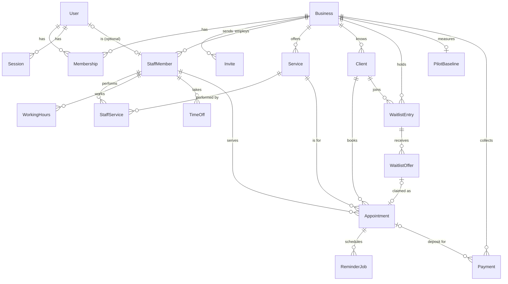

# Maw3ed — data model

Every tenant table carries `businessId`, and its indexes start with `businessId`. Times are `timestamptz` in UTC.
No free-text notes columns anywhere (NFR-04). The ERD below is hand-maintained until `prisma-erd-generator` replaces it in P4.3.

## Entities
| Entity | Key fields | Belongs to | Constraints / notes |
|---|---|---|---|
| Business | slug, name, timezone (`Asia/Beirut`), locale (`en`), currency (`USD`), slotStepMin (15), bookingWindowDays (30), minNoticeMin (60), cancelCutoffMin (1440), plan (FREE/PRO), depositThreshold (1), depositAmount (5.00), category, address | — | slug unique (lowercase, `[a-z0-9-]`, reserved words blocked); tenant root |
| User | email, passwordHash, name | — | email unique (lowercased); can belong to several businesses |
| Session | tokenHash, userId, businessId, expiresAt, lastSeenAt | User, Business | tokenHash unique; 30-day sliding expiry |
| Membership | role (OWNER, STAFF) | User, Business | unique (userId, businessId) |
| Invite | email, role, tokenHash, expiresAt, acceptedAt | Business | single use; 72 h expiry |
| StaffMember | displayName, bookable, active, colour | Business, optional User | a receptionist has a User but is not bookable; owners may be bookable |
| Service | name, durationMin, bufferMin, price, active, sortOrder | Business | soft-deactivate, never delete |
| StaffService | — | StaffMember, Service | PK (staffId, serviceId); businessId denormalised for scoping |
| WorkingHours | weekday (0–6), startLocal, endLocal (`HH:mm`) | StaffMember | several rows per day; CHECK end > start |
| TimeOff | startAt, endAt, reason enum (VACATION, SICK, OTHER) | StaffMember | UTC instants; enum, not free text |
| Client | name, phone (E.164), email, attended, noShows, lateCancels | Business | unique (businessId, phone); counters updated in the outcome transaction |
| Appointment | startAt, endAt, blockedUntil, status, source (PUBLIC, FRONT_DESK, WAITLIST), idempotencyKey, confirmedAt, cancelledAt, cancelledVia (LINK, STAFF, SYSTEM), outcomeMarkedById | Business, Client, StaffMember, Service | **exclusion constraint** on (staffId, [startAt, blockedUntil)) while BOOKED/CONFIRMED(/PENDING_PAYMENT); status also ATTENDED, NO_SHOW, CANCELLED, LATE_CANCEL; unique (businessId, idempotencyKey) |
| ReminderJob | kind (BOOKING, H24, H2), channel (EMAIL, WHATSAPP), dueAt, status (PENDING, SENDING, SENT, SKIPPED, FAILED), attempts, nextAttemptAt, lockedAt, sentAt, sentById, providerMessageId, lastError | Appointment (+ businessId) | unique (appointmentId, kind, channel); partial index (status, dueAt) where PENDING |
| WaitlistEntry | serviceId, staffId?, fromDate, toDate, status (OPEN, FULFILLED, CANCELLED) | Business, Client | |
| WaitlistOffer | entryId, staffId, startAt, endAt, expiresAt, status (OPEN, CLAIMED, EXPIRED, SUPERSEDED), claimedAppointmentId, freedFromAppointmentId, batch | Business | unique (entryId, freedFromAppointmentId): one open offer per entry per freed slot |
| PilotBaseline | fromDate, toDate, appointments, noShows, lateCancels | Business | unique (businessId); entered by the owner from their own book |
| Payment *(P3.8–3.9)* | purpose (DEPOSIT, PLAN), appointmentId?, provider, externalId, amount, currency, status (PENDING, PAID, FAILED, EXPIRED) | Business | unique (provider, externalId) |

Email sends for waitlist offers and invites are logged in `ReminderJob`-like fashion via a small `EmailLog` view, or by counting
`WaitlistOffer`/`Invite` sends, so the daily budget (NFR-10) covers every email. Decide in P2.4; prefer the simplest query that counts all sends.

## ERD

